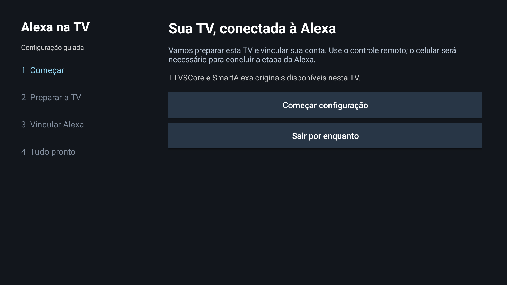
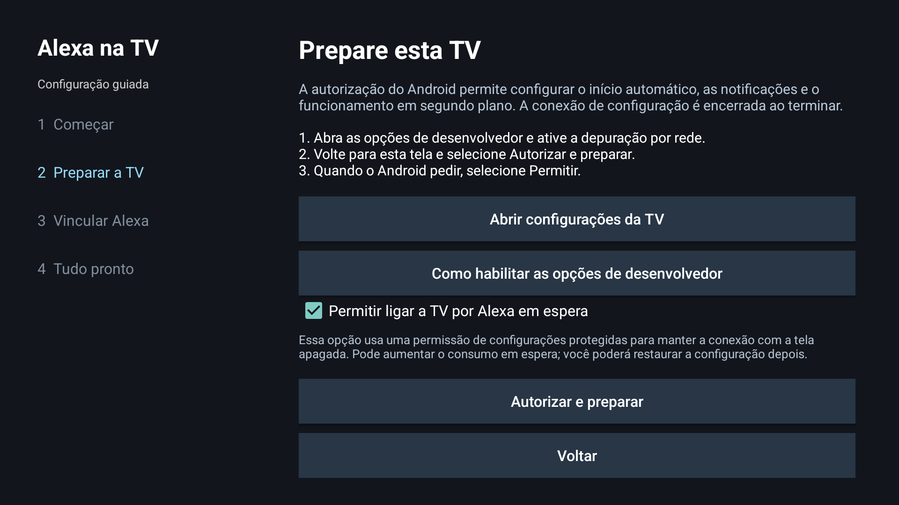
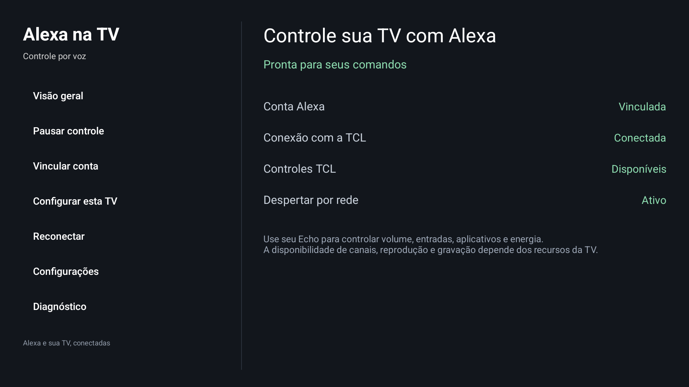

# Configuração na TV — 0.4.0

O assistente usa o controle remoto da TV. O celular é usado para o vínculo no aplicativo Alexa. Não é necessário montar um perfil JSON nem executar comandos num computador no fluxo validado.

A combinação testada é TCL C6K/G15 BR, Android 14, firmware V8-0016T01-LF1V048, TTVSCore 10.58.16 e SmartAlexa 6.13.25. A TV deve estar configurada para Brasil e conectada ao Wi-Fi. O assistente depende de ADB local na porta 5555, disponível no firmware testado. Outras combinações podem exigir adaptação.

## Baixar a ponte

No Downloader da TV, abra:

<https://github.com/eventanilha82/tcl-alexa-bridge/releases/download/v0.4.0/TCL-Alexa-Bridge-0.4.0.apk>

Instale o APK e abra **Alexa na TV**. Autorize a instalação pela fonte usada pelo Downloader quando o Android solicitar.

A ponte verifica TTVSCore e o SmartAlexa original instalado. Se o SmartAlexa estiver ausente ou antigo, escolha **Instalar SmartAlexa**. Permita que **Alexa na TV** instale aplicativos na tela do Android e volte ao assistente. Ele baixa o APK original, verifica hash, pacote, versão e certificado e abre o instalador do Android para sua confirmação.

O SmartAlexa também pode ser baixado diretamente no Downloader:

<https://github.com/eventanilha82/tcl-alexa-bridge/releases/download/v0.4.0/SmartAlexa-6.13.25.apk>

Esse componente é proprietário TCL; veja [origem, hashes e termos](../THIRD_PARTY_NOTICES.md). O app não instala TTVSCore ou firmware. Se a verificação apontar TTVSCore incompatível ou assinatura não reconhecida, resolva essa dependência antes de continuar. Um erro de assinatura numa atualização não deve ser contornado desinstalando automaticamente os aplicativos e apagando seu vínculo.

## Preparar a TV uma vez

1. Selecione **Começar configuração** e **Abrir configurações da TV**.
2. Se ainda não houver opções de desenvolvedor, vá a Sistema → Sobre e selecione a compilação/versão do Android TV sete vezes, conforme o menu da TCL.
3. Ative a depuração USB/por rede oferecida pelo firmware e volte ao assistente. O nome do menu varia; a conexão usada é exclusivamente com a própria TV, em `127.0.0.1:5555`.
4. Escolha se deseja **Permitir ligar a TV por Alexa em espera**. Essa opção pode aumentar o consumo e concede uma permissão ampla de configurações protegidas para ajustar Low Power Standby. A opção é voluntária.
5. Selecione **Autorizar e preparar**. Confirme **Permitir** na mensagem de depuração do Android.

A preparação cria uma chave ADB temporária e usa a sessão local para configurar início automático, notificações, exibição e execução em segundo plano. Com a opção de despertar marcada, também configura espera por rede e Low Power Standby. Os valores anteriores de energia são preservados para restauração. Não é necessário abrir um terminal ou fornecer tokens.

O assistente coleta os dados reais desta TV e salva o perfil no armazenamento privado. Usa o identificador nativo TCL; quando a interface direta não o fornece, tenta a identificação nativa de diagnóstico da própria TV. Não deriva Android ID, UUID ou identificador aleatório. Se não conseguir identificar a TV, informa a falha sem criar uma identidade substituta. Nesse caso, siga a orientação exibida, incluindo abrir SmartAlexa e tentar novamente quando solicitado.

Concluída a preparação, o socket local é fechado e a chave privada temporária é descartada. Isso não significa revogar permissões operacionais concedidas ao app nem apagar uma chave pública que o Android tenha lembrado. Ao terminar, você pode desativar a depuração nas configurações da TV. O funcionamento normal da ponte não mantém uma conexão ADB aberta.

## Vincular à Alexa

1. Na etapa **Vincular Alexa**, selecione **Gerar meu código**.
2. No celular, abra Alexa e o fluxo de vínculo da skill **TCL Assistant** disponível na sua conta.
3. Informe o código mostrado na TV antes de expirar. Se expirar, gere outro pelo assistente.
4. Aguarde a confirmação na TV. Ela diferencia conta vinculada de conexão/controles prontos.
5. Quando aparecer **Concluir configuração**, avance e escolha **Ir para o painel**.

O código é gerado pelo fluxo nativo do TTVSCore. Registro, confirmação do vínculo, renovação e conexão ocorrem no app; não é preciso importar credenciais. Se esta instalação já tiver vínculo válido, o assistente reconhece o estado e retoma a conexão, sem exigir um novo vínculo desnecessariamente. Dados de outra instalação não são transferidos automaticamente.

O SmartAlexa continua sendo o executor dos controles. Sua tela própria pode apresentar restrição de país; a configuração e o vínculo deste projeto são conduzidos pela ponte. Não desinstale SmartAlexa ou TTVSCore depois de vincular.

## Confirmar o funcionamento

Use no Echo o nome exato da TV cadastrado na Alexa. Comece por “Alexa, aumente o volume da TV” e “Alexa, desligue a TV”. Para quem habilitou despertar, teste ligar após um minuto em espera, depois uma noite em espera e reinício sem abrir a ponte.

Na 0.4.0, a primeira configuração em instalação isolada comprovou coleta de identidade nativa sem arquivo importado, registro sem credenciais prévias, código, confirmação, renovação, conexão e persistência. O APK final de produção preservou vínculo ao atualizar e passou por renovação/pausa/retomada, recuperação do executor/socket e volume com efeito real.

O reinício já recuperou serviço, vínculo, nuvem, executor e persistência sem abrir a interface, mantendo os ajustes de energia. O ciclo automático de 60 segundos em standby passou: desligamento nativo, conexão/executor ativos e despertar por UDP sem abrir a interface. A confirmação de voz no Echo na 0.4.0 ainda não foi feita nesta rodada. O download/instalador visível com SmartAlexa ausente, uma confirmação pelo celular numa conta inteiramente nova, a restauração de energia pela interface e uma noite em espera não foram exercitados nesta rodada; isso delimita o teste, sem indicar falha observada. Confira o [relatório atual](qa-v0.4.0.md) e os [limites de validação](validation.md).

## Recuperação e opções avançadas

Se a TV não oferecer ADB local na porta 5555, o assistente informa que a preparação não está disponível nesse firmware. Não troque o país ou invente identificadores para contornar a falha. Relate modelo, firmware e etapa que falhou, sem publicar IDs, MACs, códigos ou tokens.

Para refazer permissões ou alterar a opção de standby, abra **Configurar esta TV** no painel. Para restaurar energia e atualizar/reverter builds, consulte [recuperação](rollback.md).
